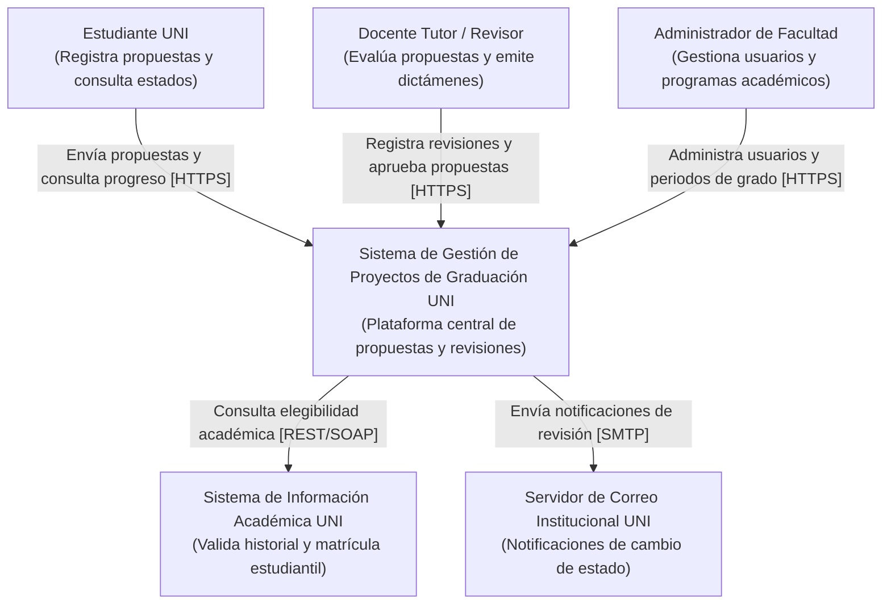
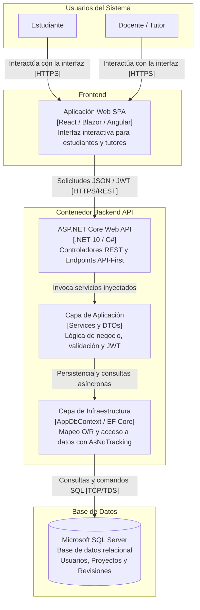
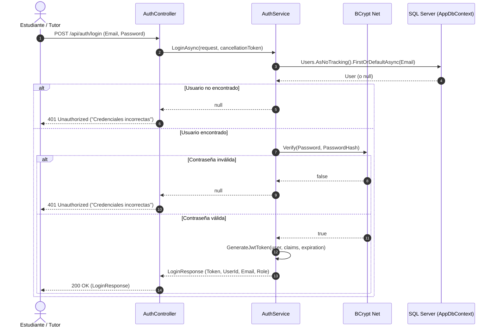
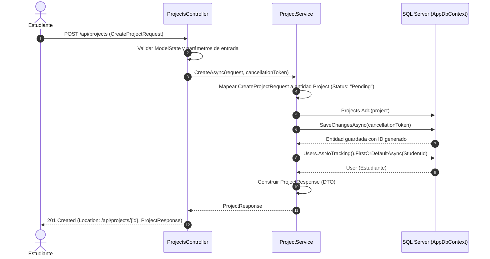
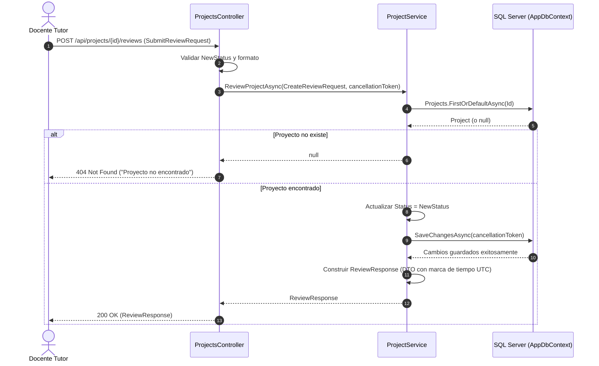

# Sistema de Gestión de Proyectos de Graduación de la UNI

## 1. Descripción Breve del Sistema

El **Sistema de Gestión de Proyectos de Graduación de la UNI** es una plataforma backend diseñada bajo el estándar **ASP.NET Core Web API** y **Entity Framework Core**, conectada a **Microsoft SQL Server**. El sistema tiene como objetivo centralizar, automatizar y auditar el ciclo de vida de los proyectos y tesis de graduación en la Universidad Nacional de Ingeniería (UNI).

Permite a los estudiantes registrar propuestas de grado, consultar el estado de sus proyectos, y a los docentes tutores emitir revisiones y dictámenes formales. La solución implementa principios de **Clean Architecture** (separación estricta de responsabilidades entre Api, Application, Domain e Infrastructure), enfoque **API-First**, controladores delgados (*Thin Controllers*), inyección de dependencias, hashing seguro de contraseñas con **BCrypt**, autenticación sin estado mediante **JWT**, y optimizaciones de alto rendimiento utilizando `.AsNoTracking()` y operaciones asíncronas con `CancellationToken`.

---

## 2. Diagrama C4 Nivel 1: Contexto del Sistema

Este diagrama ilustra a los actores principales y las interacciones de alto nivel con el Sistema de Gestión de Proyectos de Graduación y los sistemas externos vinculados.

---

## 3. Diagrama C4 Nivel 2: Contenedores

Este diagrama detalla la arquitectura de contenedores internos del sistema, sus responsabilidades y los protocolos de comunicación.

---

## 4. Diagrama de Secuencia: Autenticación (Login)

Flujo de inicio de sesión seguro verificando credenciales con BCrypt y emitiendo un token JWT.

---

## 5. Diagrama de Secuencia: Registrar Propuesta de Proyecto

Flujo de creación de una nueva propuesta de graduación con controladores delgados y desacoplamiento de entidades mediante DTOs.

---

## 6. Diagrama de Secuencia: Revisión del Tutor

Flujo de emisión de dictamen y retroalimentación de un proyecto por parte de un tutor o revisor.

---

## 7. Tabla de la API Principal

A continuación se resumen los endpoints desarrollados en la API, detallando sus rutas, métodos HTTP, modelos de datos de entrada/salida y códigos de estado:

| Método | Ruta Endpoint | Descripción | Request Body (DTO) | Response Body (DTO) | Códigos HTTP |
| :--- | :--- | :--- | :--- | :--- | :--- |
| `POST` | `/api/auth/login` | Autentica a un usuario y genera su token JWT firmado. | `LoginRequest` (`Email`, `Password`) | `LoginResponse` (`Token`, `UserId`, `Email`, `Role`) | `200 OK` `401 Unauthorized` |
| `GET` | `/api/projects/mine` | Lista los proyectos asociados al estudiante actual usando `.AsNoTracking()`. | N/A *(Query param opcional `studentId` o claim JWT)* | `IEnumerable<ProjectResponse>` | `200 OK` `400 Bad Request` |
| `POST` | `/api/projects` | Registra una nueva propuesta de proyecto de graduación. | `CreateProjectRequest` (`Title`, `Description`, `StudentId`) | `ProjectResponse` (`Id`, `Title`, `Description`, `Status`, `StudentId`, `StudentEmail`) | `201 Created` `400 Bad Request` |
| `GET` | `/api/projects/{id}` | Obtiene los detalles de un proyecto específico por su identificador. | N/A *(Parámetro de ruta `id`)* | `ProjectResponse` (`Id`, `Title`, `Description`, `Status`, `StudentId`, `StudentEmail`) | `200 OK` `404 Not Found` |
| `POST` | `/api/projects/{id}/reviews` | Registra la revisión de un tutor y actualiza el estado del proyecto. | `SubmitReviewRequest` (`Comments`, `NewStatus`) | `ReviewResponse` (`ProjectId`, `Comments`, `Status`, `ReviewedAt`) | `200 OK` `400 Bad Request` `404 Not Found` |

---

## 8. Consideraciones Técnicas y de Seguridad

- **Seguridad de Credenciales:** Las contraseñas nunca se persisten ni comparan en texto plano; se implementa el algoritmo de derivación de claves **BCrypt**.
- **Gestión de Secretos:** La cadena de conexión y la clave de firma JWT no se encuentran hardcodeadas en clases de C#, administrándose mediante el sistema de configuración de ASP.NET Core (`appsettings.json` o variables de entorno en producción).
- **Rendimiento:** Las operaciones de lectura aplican `.AsNoTracking()` para prescindir de la sobrecarga del seguimiento de cambios en memoria de Entity Framework Core.
- **Asincronía Total:** Todas las llamadas a base de datos y flujos de I/O son no bloqueantes (`async/await`) y propagan un `CancellationToken` para optimizar la cancelación temprana de solicitudes.
- **Encapsulación de Entidades:** El modelo de dominio (`User`, `Project`) nunca se expone directamente a los clientes de la API, intermediando a través de DTOs inmutables implementados con `record`.